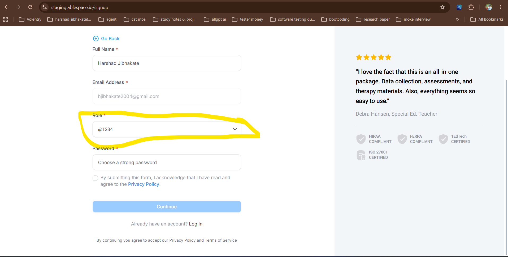

# Bug Report: BUG-02

| **Field** | **Description** |
|---|---|
| **Bug ID** | BUG-02 |
| **Title** | "Role" dropdown allows arbitrary text filtering to append as a new selectable list option. |
| **Severity** | High |
| **Priority** | High |
| **Environment** | Account Setup Registration Page |
| **Browser / Device** | Google Chrome (Desktop) |
| **Reproducibility** | Always |
| **Steps to Reproduce** | 1. Navigate to the account creation setup screen. 2. Click the mandatory **Role** dropdown menu to expand the available choices. 3. Instead of selecting an existing option, type a random string containing numbers and symbols (e.g., `@123`) into the search/filter input. 4. Observe the options displayed in the dropdown list. |
| **Expected Result** | The dropdown should filter the predefined roles based on the entered text or display a "No results found" message. Arbitrary text should not be added as a selectable option unless the application explicitly supports custom roles with appropriate validation. |
| **Actual Result** | The system dynamically appends the unvalidated search query (`@123`) as a selectable option at the bottom of the list, potentially allowing users to bypass the predefined role requirements. |
| **Evidence** |  |
