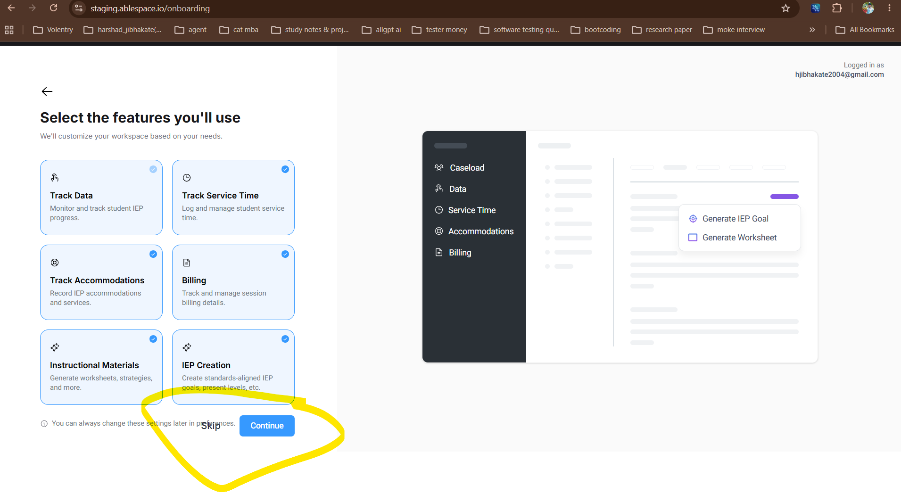

# Bug Report: BUG-03

| **Field** | **Description** |
|---|---|
| **Bug ID** | BUG-03 |
| **Title** | "Skip" button text overlaps with the subtext statement on the "Select features" onboarding screen. |
| **Severity** | Low |
| **Priority** | Medium |
| **Environment** | [https://ablespace.io](https://ablespace.io) |
| **Browser / Device** | Google Chrome (Desktop) |
| **Reproducibility** | Always |
| **Steps to Reproduce** | 1. Log in to the application staging workspace. 2. Progress to the features customization screen titled "Select the features you'll use". 3. Navigate to the bottom section near the blue **Continue** button. 4. Observe the position of the **Skip** option relative to the explanatory subtext paragraph. |
| **Expected Result** | The **Skip** button should be positioned separately from the informational text, with appropriate spacing and clear layout boundaries. The surrounding text should remain fully visible and readable. |
| **Actual Result** | The **Skip** button text overlaps the informational subtext, obscuring part of the word "preferences" and making the sentence broken and difficult to read. |
| **Evidence** |  |
