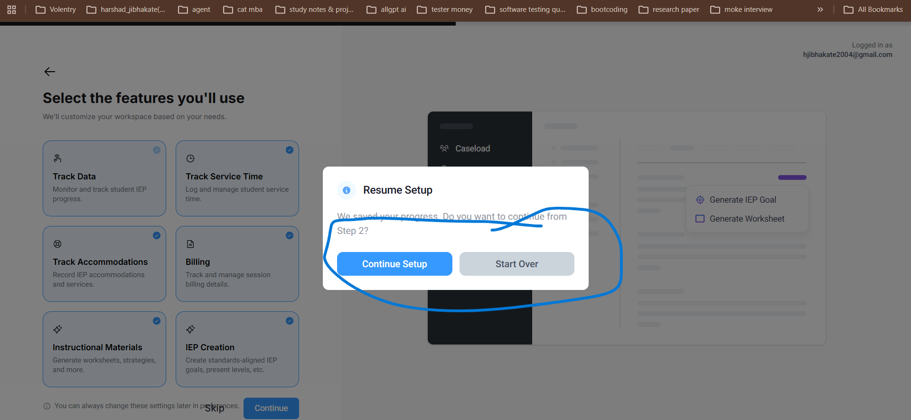

# Bug Report: BUG-04

| **Field** | **Description** |
|---|---|
| **Bug ID** | BUG-04 |
| **Title** | "Start Over" Button on "Resume Setup" Modal Does Not Redirect to the First Onboarding Page Without Manual Refresh |
| **Severity** | High |
| **Priority** | High |
| **Environment** | [https://ablespace.io](https://ablespace.io) |
| **Browser / Device** | Google Chrome (Desktop) |
| **Reproducibility** | Always |

## Steps to Reproduce

1. Log in to the application workspace with existing saved setup progress.
2. Navigate to the onboarding flow to trigger the **Resume Setup** modal.
3. Click the **Start Over** button inside the modal.
4. Observe whether the application automatically redirects to Step 1 of the onboarding flow.

## Expected Result

Clicking the **Start Over** button should clear the previously saved setup progress and automatically redirect the user to the first step of the onboarding flow without requiring a manual browser refresh.

## Actual Result

Clicking the **Start Over** button does not immediately trigger page redirection or update the onboarding state. The user remains on the current screen until manually refreshing the browser.

## Evidence

 |
**Video Recording:** `bug-04-video.mp4`

[View Bug Reproduction Video](bug-04-video.mp4)
