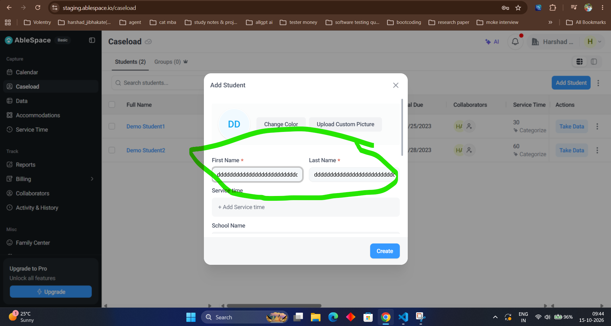

# Bug Report: BUG-7

| **Field** | **Description** |
|---|---|
| **Bug ID** | BUG-7 |
| **Title** | "First Name" and "Last Name" Fields Accept Excessively Long Text Strings Without Character Limit Validation |
| **Severity** | Low |
| **Priority** | Medium |
| **Environment** | [https://staging.ablespace.io/caseload](https://staging.ablespace.io/caseload) |
| **Browser / Device** | Google Chrome (Desktop) |
| **Reproducibility** | Always |

## Steps to Reproduce

1. Navigate to the [Caseload page](https://staging.ablespace.io/caseload).
2. Click the **Add Student** button to open the creation modal.
3. Enter an excessively long character string into the **First Name** field.
4. Enter an excessively long character string into the **Last Name** field.
5. Observe whether the form accepts the unrestricted text length without displaying validation errors or truncating the input.

## Expected Result

The **First Name** and **Last Name** fields should enforce a maximum character length limit, restrict input beyond that threshold, or display an appropriate validation warning.

## Actual Result

The system accepts excessively long text strings in both name fields without enforcing a character limit, truncating the input, or displaying any validation errors.

## Evidence

 |
