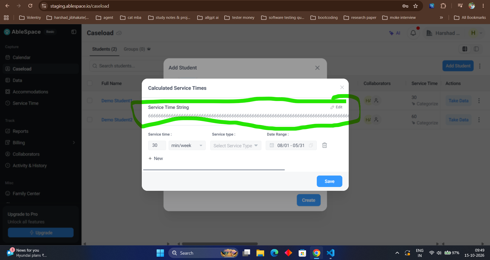

# Bug Report: BUG-8

| **Field** | **Description** |
|---|---|
| **Bug ID** | BUG-8 |
| **Title** | "Service Time String" Field Accepts Excessively Long Strings Without Character Limit Validation or Layout Constraints |
| **Severity** | Low |
| **Priority** | Medium |
| **Environment** | [https://staging.ablespace.io/caseload](https://staging.ablespace.io/caseload) |
| **Browser / Device** | Google Chrome (Desktop) |
| **Reproducibility** | Always |

## Steps to Reproduce

1. Navigate to the [Caseload page](https://staging.ablespace.io/caseload) and open the **Add Student** modal.
2. Open the **Calculated Service Times** section or modal.
3. Locate the **Service Time String** field.
4. Enter or paste an excessively long sequence of characters or numbers (e.g., repeating digits like `666666666666666666666666666666666666666666666666666666666666`).
5. Observe whether the field accepts the unrestricted input length, causing text overflow or breaking the visual boundaries.

## Expected Result

The **Service Time String** field should enforce a maximum character length limit, restrict input beyond that threshold, or wrap or truncate text appropriately to maintain the UI layout and prevent visual overflow.

## Actual Result

The field accepts an excessively long string of characters without validation, resulting in text overflow and broken layout formatting.

## Evidence
 |