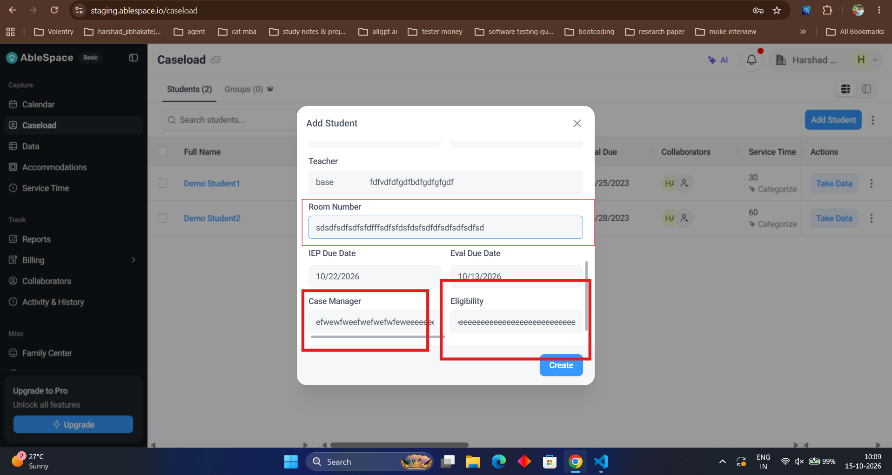

# Bug Report: BUG-9

| **Field** | **Description** |
|---|---|
| **Bug ID** | BUG-9 |
| **Title** | "Room Number" Field Accepts Non-Numeric Text, and "Case Manager" and "Eligibility" Fields Lack Character Length Limits |
| **Severity** | Medium |
| **Priority** | Medium |
| **Environment** | [https://staging.ablespace.io/caseload](https://staging.ablespace.io/caseload) |
| **Browser / Device** | Google Chrome (Desktop) |
| **Reproducibility** | Always |

## Steps to Reproduce

1. Navigate to the **Caseload** page and open the **Add Student** modal.
2. Enter alphabetical text into the **Room Number** field (e.g., `sdsdfsdfsdfsfdfsdfsdfsdfsdfdsfdsfdsfsd`).
3. Enter excessively long text strings into the **Case Manager** and **Eligibility** fields.
4. Observe whether the **Room Number** field accepts non-numeric text and whether the other fields enforce character length limits.

## Expected Result

The **Room Number** field should accept only numeric digits and reject non-numeric input. The **Case Manager** and **Eligibility** fields should enforce appropriate maximum character length limits.

## Actual Result

The **Room Number** field accepts non-numeric and alphabetical text without validation, while the **Case Manager** and **Eligibility** fields allow excessively long text without enforcing character length restrictions.

## Evidence

 |
